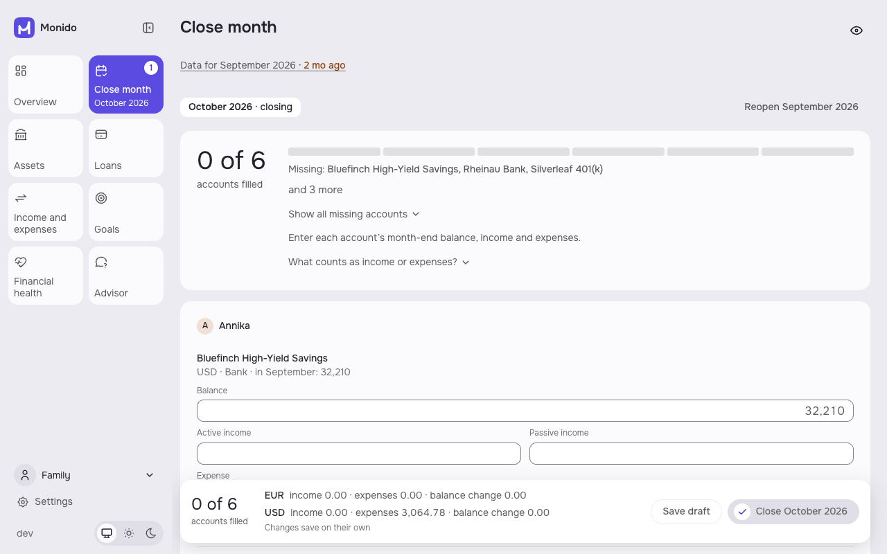
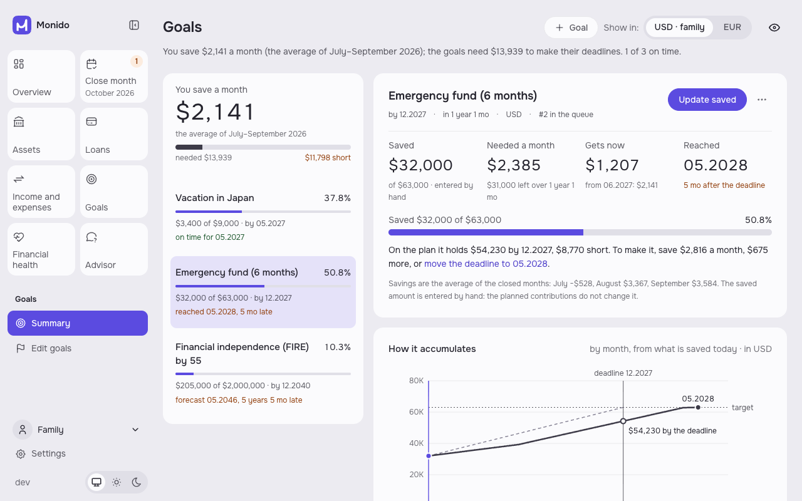
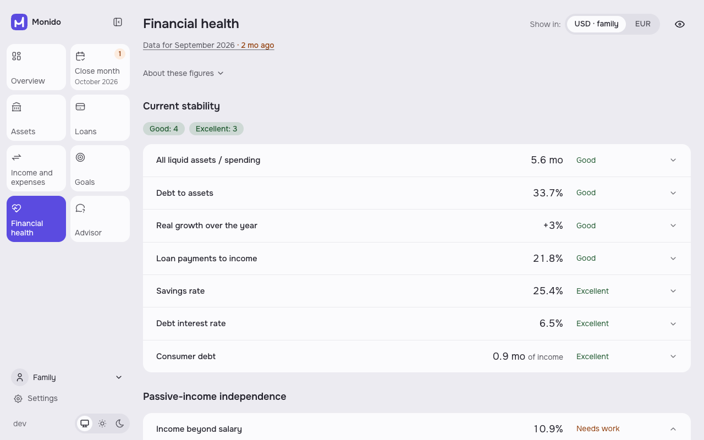
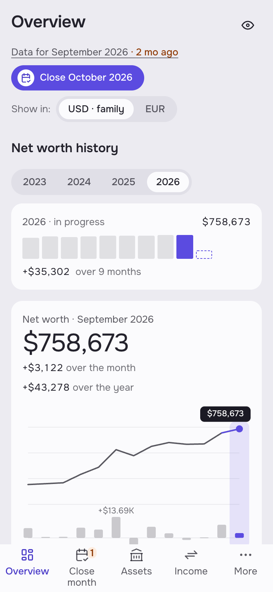

<p align="center"><a href="README.md">English</a> · <a href="README.ru-RU.md">Русский</a> · <a href="README.de-DE.md">Deutsch</a> · <a href="README.es-ES.md">Español</a> · <a href="README.fr-FR.md">Français</a> · <a href="README.pt-BR.md">Português</a> · <a href="README.zh-CN.md">中文</a></p>

<p align="center">
  
</p>

<h1 align="center">Monido</h1>

<p align="center">
  Behalten Sie Ihr Nettovermögen und Ihre Einnahmen und Ausgaben im Blick, allein oder als Familie. Selbst gehostet, von Hand eingetragen, ohne Bankanbindung.
</p>

<p align="center">
  <a href="https://github.com/stanislav-petryashov/monido/releases/latest"></a>
  <a href="https://github.com/stanislav-petryashov/monido/actions/workflows/docker.yml"></a>
  <a href="LICENSE"></a>
  <a href="https://github.com/stanislav-petryashov/monido/commits/master"></a>
  <a href="https://github.com/stanislav-petryashov/monido/pkgs/container/monido"></a>
  <a href="https://demo.monido.dev"></a>
  <a href="https://registry.modelcontextprotocol.io/v0.1/servers?search=io.github.stanislav-petryashov/monido"></a>
</p>

<p align="center">
  <a href="https://monido.dev">Website</a> · <a href="https://demo.monido.dev">Live-Demo</a> · <a href="#schnellstart">Schnellstart</a> · <a href="#dokumentation-auf-englisch">Doku</a> · <a href="#mitwirken">An Monido mitarbeiten</a> · <a href="https://github.com/stanislav-petryashov/monido/releases">Releases</a>
</p>

<p align="center">
  <a href="https://demo.monido.dev">Live-Demo ausprobieren</a>: eine erfundene Familie in einer privaten Kopie für 15 Minuten, ohne Installation; das Passwort steht auf dem Anmeldebildschirm.
</p>

<p align="center">
  
</p>

## Welche Fragen Monido beantwortet

- **Wie viel besitzen wir nach Abzug der Schulden?** Konten, Geldanlagen, Immobilien und Kredite aller Familienmitglieder, in jeder Währung, in einer Zahl. [Beispiel](docs/use-cases/family-net-worth.md)
- **Sind wir dieses Jahr reicher geworden, oder haben sich nur Preise und Wechselkurse bewegt?** Das Nettovermögen im Zeitverlauf und sein reales Wachstum nach Inflation in der Währung, in der Sie ausgeben. [Beispiel](docs/use-cases/wealth-change.md) · [Formel](docs/finance-rules.md#rule-4-real-net-worth-growth-real_growth_yoy)
- **Wie viel haben wir selbst gespart, und wie viel ist von allein gewachsen?** Ersparnisse und Sparquote pro Monat und das Wachstum darüber hinaus. [Beispiel](docs/use-cases/monthly-savings.md) · [Formel](docs/finance-rules.md#growth-beyond-savings-growth_beyond_savings)
- **Wie lange kämen wir ohne Einkommen aus?** Der Notgroschen in Monaten an Ausgaben. [Beispiel](docs/use-cases/emergency-reserve.md) · [Formel](docs/finance-rules.md#rule-1-emergency-fund-emergency_months)
- **Wann erreichen wir unsere Ziele, und können wir uns das leisten?** Zieltermine aus dem, was Sie tatsächlich sparen; mit dem optionalen Claude-Berater wird ein Kauf oder ein Kredit an Ihren eigenen Zahlen gemessen und der Familie zur Abstimmung vorgelegt. [Ziele](docs/use-cases/savings-goal.md) · [Eine Familienentscheidung](docs/use-cases/family-decision.md)

## Schnellstart

Sie brauchen Docker mit Docker Compose v2.24 oder neuer (Linux oder Docker Desktop unter macOS). In einem neuen Ordner:

```bash
mkdir monido && cd monido
curl -fsSLO https://raw.githubusercontent.com/stanislav-petryashov/monido/master/docker-compose.yml
docker compose up -d
```

Öffnen Sie innerhalb von 15 Minuten http://127.0.0.1:8080 und legen Sie das Familienpasswort fest. Servereinstellungen (Port, Adresse) gehören in eine optionale `.env` ([`.env.example`](.env.example), [die vollständige Anleitung](docs/deploy-docker.md#installation)). Zum Aktualisieren: `docker compose pull && docker compose up -d`. Etwas funktioniert nicht? [Fehlerbehebung](docs/deploy-docker.md#troubleshooting).

**Was es braucht:** einen Container (Node und SQLite, kein separater Datenbankserver) für amd64 und arm64, ein Raspberry Pi oder ein NAS genügt also; im Leerlauf unter 60 MB Arbeitsspeicher (`docker stats` auf der Demo und einer Installation zu Hause, Versionen 1.2 bis 1.4) und ein Image von 250 MB.

Die Daten liegen in einem Docker-Volume, das nach dem Ordner benannt ist (`monido_data`); `docker compose down -v` würde es löschen, hängen Sie also nie `-v` an. Die Demo hat keinen Claude-Berater und keine Telegram-Erinnerungen und kann ihre Datenbank nicht herunterladen; Ihre eigene Installation hat das alles.

## Ansichten

<table>
  <tr>
    <td width="50%"><br><sub><b>Monat abschließen</b>: einmal im Monat, gespeichert beim Tippen</sub></td>
    <td width="50%"><br><sub><b>Ziele</b>: Termine aus dem, was Sie tatsächlich sparen, und was sie verschieben würde</sub></td>
  </tr>
  <tr>
    <td width="50%"><br><sub><b>Finanzielle Gesundheit</b>: jede Zahl mit ihrem Schwellenwert und ihrer Formel</sub></td>
    <td width="50%"><br><sub><b>Berater</b> (optional): eine Entscheidung mit ihren Folgen, über die die Familie abstimmt</sub></td>
  </tr>
</table>

<p align="center"></p>

## Wie es funktioniert und was es nicht ist

Einmal im Monat trägt die Familie den Saldo jedes Kontos zum Monatsende ein und, wenn Sie die Zahlen zu Einnahmen und Ausgaben möchten, die Einnahmen und Ausgaben des Monats; „Monat abschließen“ prüft, ob jedes Konto ausgefüllt ist, und nimmt den Monat dann ins Dashboard auf. Nur abgeschlossene Monate zählen, jede Zahl berechnet die App aus dem Eingetragenen, und jede Formel ist in den [Finanzregeln](docs/finance-rules.md) aufgeschrieben.

Monido passt zu Ihnen, wenn Sie einen Container auf einem Heimserver, einem NAS oder einem VPS betreiben können, das Geld der Familie auf mehrere Banken, Währungen und Immobilien verteilt ist und Sie das Vermögen und seine Richtung sehen wollen statt jedes einzelnen Einkaufs.

Es ist kein tägliches Haushaltsbuch, kein Umschlagbudget und kein Depot-Tracker mit Live-Kursen, und es verbindet sich nie mit einer Bank und bewegt kein Geld. Für ein Haushaltsbuch Buchung für Buchung oder Budgets schauen Sie sich Firefly III oder Actual Budget an, für Live-Kurse von Geldanlagen Ghostfolio.

## Funktionen

- **Nettovermögen, Einnahmen und Ausgaben:** Monatsverlauf, Aufteilung nach Inhaber, Währung und Anlageart, Kategorien für Einnahmen und Ausgaben, Sparquoten; für den Anfang genügen die Salden.
- **Kredite und Immobilien:** Tilgungspläne, Vergleiche von Sondertilgungen und Immobilienbewertungen.
- **Ziele und finanzielle Unabhängigkeit:** Fortschritt, Prognosen, Alternativen und die Rechnung hinter jedem Termin.
- **Finanzielle Gesundheit:** Kennzahlen mit ihren Schwellenwerten und Eingangsdaten; fehlende Daten werden angezeigt und nie als null gewertet.
- **Für die Familie:** gemeinsame Einträge, Anmeldung mit einem Familienpasswort oder einzeln über Telegram, Rechte pro Mitglied, Erinnerungen und Vorschläge in Telegram.
- **Selbst hosten:** Sicherung und Wiederherstellung, alle Daten als CSV exportierbar, Änderungsverlauf mit Rückgängig, mehrere Währungen, sieben Sprachen, helles und dunkles Design.

## Datenschutz und KI

Ihre Daten bleiben in der SQLite-Datenbank auf Ihrem Server. Der Server selbst sendet nur eine Anfrage nach Wechselkursen (an Frankfurter oder an Ihre eigene Instanz) und einmal am Tag den Image-Namen, um nach Updates zu suchen (`UPDATE_CHECK=off` schaltet das ab); Telegram wird nur kontaktiert, wenn Sie es einschalten. Der Kern enthält keine KI: Der Claude-Berater ist aus, bis Sie Ihr eigenes Claude-Konto verbinden, und dann gehen Ihr Gespräch und die Zahlen, die Claude abfragt, über dieses Konto an Anthropic, nie über die App.

## Projektstatus

Monido ist jung: Seine öffentliche Geschichte beginnt im November 2026, es hat einen Maintainer und erscheint oft in neuen Versionen (siehe [Releases](https://github.com/stanislav-petryashov/monido/releases) und das [Changelog](CHANGELOG.md)). Updates erhalten Ihre Daten: Eine vorhandene Datenbank wird bei jedem Start geprüft und nie ohne Ihr Wissen verändert, und Sie können vor dem Update [eine Kopie herunterladen](docs/deploy-docker.md#backup-and-restore). Fünf der sieben Sprachen sind maschinelle Übersetzungen, die noch geprüft werden müssen. Was als Nächstes kommt, steht in der [Roadmap](https://github.com/stanislav-petryashov/monido/discussions/27).

## Bezugsquellen

- **Docker Compose** auf jedem Linux-Server oder mit Docker Desktop: siehe [Schnellstart](#schnellstart). Das Image ist `ghcr.io/stanislav-petryashov/monido` (amd64 und arm64).
- **Unraid:** Suchen Sie in den Community Applications nach Monido. Es läuft als Eigentümer des Datenordners (standardmäßig `PUID` 99, `PGID` 100).
- **PikaPods** (verwaltetes Hosting): noch nicht verfügbar. [Stimmen Sie für Monido](https://feedback.pikapods.com/posts/1289/monido-self-hosted-family-net-worth-and-cash-flow-tracker), damit es aufgenommen wird.
- **Claude-Connector (MCP):** eingetragen in der [offiziellen MCP Registry](https://registry.modelcontextprotocol.io/v0.1/servers?search=io.github.stanislav-petryashov/monido) und auf [Glama](https://glama.ai/mcp/servers/stanislav-petryashov/monido).

## Sprachen

Die Oberfläche gibt es auf Englisch, Russisch, Deutsch, Spanisch, Französisch, brasilianischem Portugiesisch und vereinfachtem Chinesisch. Die deutschen, spanischen, französischen, portugiesischen und chinesischen Texte sind maschinelle Übersetzungen, die noch von Muttersprachlern geprüft werden müssen. Korrekturen sind willkommen: siehe [Übersetzen](docs/translating.md). Diese README ist eine Übersetzung der englischen; bei Abweichungen gilt die englische Fassung.

[](https://hosted.weblate.org/engage/monido/)

Die Übersetzungen werden auf [Weblate](https://hosted.weblate.org/engage/monido/) gepflegt: Wählen Sie Ihre Sprache, korrigieren oder bestätigen Sie Texte, und die Änderungen kommen als Pull Request in dieses Repository zurück.

## Dokumentation (auf Englisch)

- [Durchgerechnete Beispiele](docs/use-cases/README.md): sieben Fragen aus dem Haushalt mit erfundenen Daten, Prüfergebnissen und Grenzen.
- [Benutzerhandbuch](docs/user-guide.md): die Seiten, die monatliche Aktualisierung und die Einstellungen.
- [Konfiguration](docs/configuration.md): Umgebungsvariablen, Anmeldemodi und optionale Integrationen.
- [Bereitstellung](docs/deploy-docker.md): Docker, HTTPS hinter einem Reverse Proxy, Updates und Sicherungen, die öffentliche Demo.
- [Entwicklung](docs/development.md): Start aus dem Quellcode, die Befehle und die Screenshots.
- [Architektur](docs/architecture.md): die Code-Übersicht, das Datenmodell und Anleitungen.
- [Finanzregeln](docs/finance-rules.md): wie jede Kennzahl berechnet und bewertet wird.
- [Datenbankschema](docs/schema.md): die aktuellen Tabellen und die Kompatibilitätsregeln.
- [Designsystem](docs/design-system.md): Tokens, Komponenten und Regeln für die Oberfläche.
- [Maintenance](docs/maintaining.md): das erste öffentliche Release und das Erstellen eines Releases.

## Mitwirken

Beiträge können Code sein, verständlichere Dokumentation, Korrekturen an Übersetzungen, Verbesserungen der Barrierefreiheit, Nachprüfungen der Berechnungen oder Berichte aus einer echten selbst gehosteten Installation.

Beginnen Sie mit [CONTRIBUTING.md](CONTRIBUTING.md) für die Einrichtung und die Richtlinien für Beiträge. [Eröffnen Sie ein Issue](https://github.com/stanislav-petryashov/monido/issues/new/choose), um ein Problem zu melden; Fragen und Ideen, auch vor einer größeren Änderung, besprechen Sie in den [Discussions](https://github.com/stanislav-petryashov/monido/discussions). Issues mit dem Label [good first issue](https://github.com/stanislav-petryashov/monido/labels/good%20first%20issue) sind ein kleiner, abgeschlossener Einstieg. Sie möchten einen Bereich über längere Zeit mitbetreuen? Schreiben Sie uns, welchen Teil Sie nutzen und an welchem Sie arbeiten möchten.

Wenn Monido Ihnen nützt, helfen ein Stern oder eine Empfehlung an jemanden, der es braucht, dem Projekt.

## Sicherheit

Anmeldung, Sitzungen, Drosselung, die Content-Security-Policy und wie Sie eine Schwachstelle vertraulich melden: [SECURITY.md](SECURITY.md).

## Lizenz

[MIT](LICENSE).
