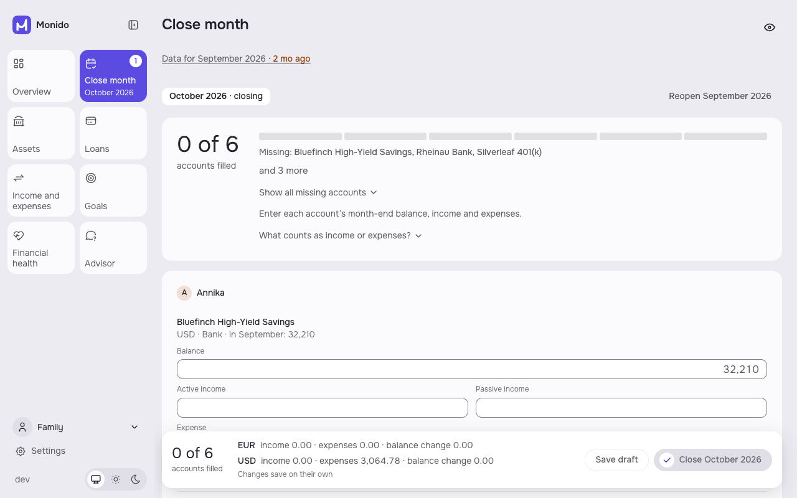
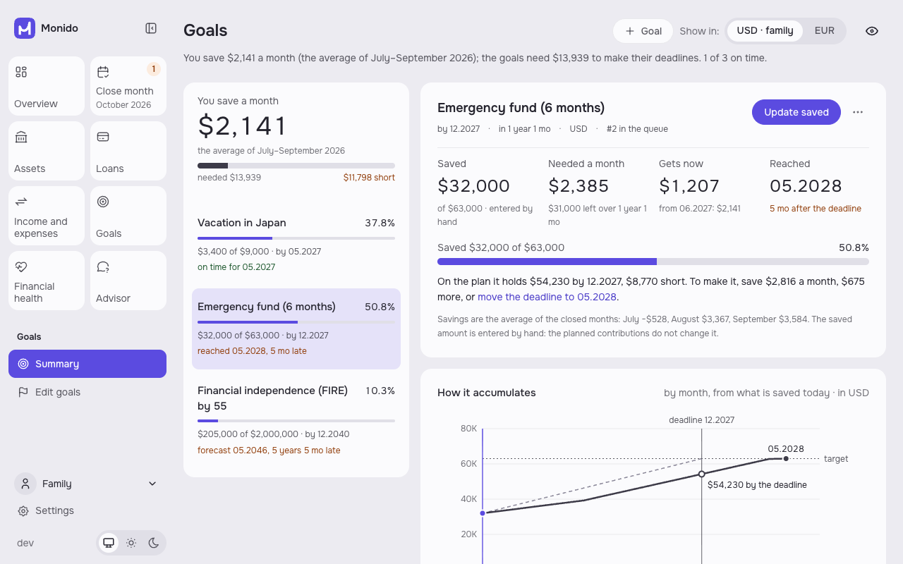
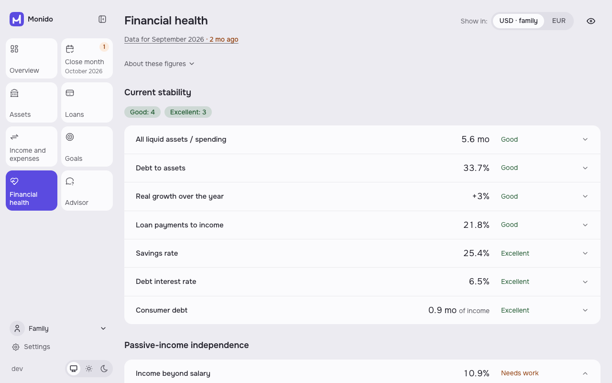
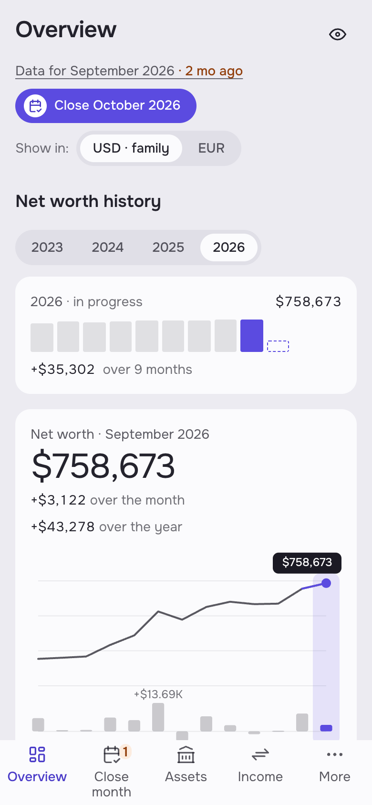

<p align="center"><a href="README.md">English</a> · <a href="README.ru-RU.md">Русский</a> · <a href="README.de-DE.md">Deutsch</a> · <a href="README.es-ES.md">Español</a> · <a href="README.fr-FR.md">Français</a> · <a href="README.pt-BR.md">Português</a> · <a href="README.zh-CN.md">中文</a></p>

<p align="center">
  
</p>

<h1 align="center">Monido</h1>

<p align="center">
  Acompanhe seu patrimônio líquido, suas receitas e despesas, sozinho ou em família. Auto-hospedado, com dados digitados à mão, sem conexão com bancos.
</p>

<p align="center">
  <a href="https://github.com/stanislav-petryashov/monido/releases/latest"></a>
  <a href="https://github.com/stanislav-petryashov/monido/actions/workflows/docker.yml"></a>
  <a href="LICENSE"></a>
  <a href="https://github.com/stanislav-petryashov/monido/commits/master"></a>
  <a href="https://github.com/stanislav-petryashov/monido/pkgs/container/monido"></a>
  <a href="https://demo.monido.dev"></a>
  <a href="https://registry.modelcontextprotocol.io/v0.1/servers?search=io.github.stanislav-petryashov/monido"></a>
</p>

<p align="center">
  <a href="https://monido.dev">Site</a> · <a href="https://demo.monido.dev">Demo ao vivo</a> · <a href="#início-rápido">Início rápido</a> · <a href="#documentação">Documentação</a> · <a href="#como-contribuir">Ajude a construir o Monido</a> · <a href="https://github.com/stanislav-petryashov/monido/releases">Versões</a>
</p>

<p align="center">
  <a href="https://demo.monido.dev">Experimente a demo ao vivo</a>: uma família fictícia em uma cópia privada por 15 minutos, nada para instalar; a tela de login mostra a senha.
</p>

<p align="center">
  
</p>

## Perguntas que o Monido responde

- **Quanto temos, descontadas as dívidas?** Contas, investimentos, imóveis e empréstimos de cada membro da família, em todas as moedas, em um só número. [Exemplo](docs/use-cases/family-net-worth.md)
- **Ficamos mais ricos este ano, ou foram os preços e o câmbio que mudaram?** O patrimônio líquido ao longo do tempo e seu crescimento real, descontada a inflação, na moeda em que você gasta. [Exemplo](docs/use-cases/wealth-change.md) · [fórmula](docs/finance-rules.md#rule-4-real-net-worth-growth-real_growth_yoy)
- **Quanto nós mesmos poupamos e quanto cresceu sozinho?** O valor poupado e a taxa de poupança de cada mês, e o crescimento além deles. [Exemplo](docs/use-cases/monthly-savings.md) · [fórmula](docs/finance-rules.md#growth-beyond-savings-growth_beyond_savings)
- **Por quanto tempo aguentaríamos sem renda?** A reserva de emergência em meses de despesas. [Exemplo](docs/use-cases/emergency-reserve.md) · [fórmula](docs/finance-rules.md#rule-1-emergency-fund-emergency_months)
- **Quando alcançamos nossas metas, e podemos pagar por isto?** Datas das metas a partir do que vocês realmente poupam; com o Consultor opcional do Claude, uma compra ou um empréstimo avaliado com os seus próprios números e enviado à família para votação. [Metas](docs/use-cases/savings-goal.md) · [Uma decisão em família](docs/use-cases/family-decision.md)

## Início rápido

Você precisa do Docker com o Docker Compose v2.24 ou mais recente (Linux, ou Docker Desktop no macOS). Em uma pasta nova:

```bash
mkdir monido && cd monido
curl -fsSLO https://raw.githubusercontent.com/stanislav-petryashov/monido/master/docker-compose.yml
docker compose up -d
```

Abra http://127.0.0.1:8080 em até 15 minutos e defina a senha da família. As configurações do servidor (porta, endereço) ficam em um `.env` opcional ([`.env.example`](.env.example), [o guia completo](docs/deploy-docker.md#installation)). Para atualizar: `docker compose pull && docker compose up -d`. Algo não funciona? [Solução de problemas](docs/deploy-docker.md#troubleshooting).

**Do que ele precisa:** um contêiner (Node e SQLite, sem servidor de banco de dados separado) para amd64 e arm64, então um Raspberry Pi ou um NAS dá conta; menos de 60 MB de memória em repouso (`docker stats` na demo e em uma instalação doméstica, versões 1.2 a 1.4) e uma imagem de 250 MB.

Os dados ficam em um volume do Docker com o nome da pasta (`monido_data`); `docker compose down -v` apagaria esse volume, então nunca acrescente `-v`. A demo não tem o Consultor do Claude nem os lembretes do Telegram e não permite baixar o banco de dados; a sua própria instalação tem tudo isso.

## Telas

<table>
  <tr>
    <td width="50%"><br><sub><b>Fechar o mês</b>: uma vez por mês, salvo enquanto você digita</sub></td>
    <td width="50%"><br><sub><b>Metas</b>: datas a partir do que vocês realmente poupam, e o que as mudaria</sub></td>
  </tr>
  <tr>
    <td width="50%"><br><sub><b>Saúde financeira</b>: cada número com seu limite e sua fórmula</sub></td>
    <td width="50%"><br><sub><b>Consultor</b> (opcional): uma decisão com suas consequências, votada pela família</sub></td>
  </tr>
</table>

<p align="center"></p>

## Como funciona e o que ele não é

Uma vez por mês, a família informa o saldo de cada conta no fim do mês e, se quiser os números de receitas e despesas, as receitas e despesas do mês; Fechar o mês confere se todas as contas foram preenchidas e então inclui o mês no painel. Só os meses fechados contam, todo número é calculado pelo app a partir do que foi informado, e cada fórmula está descrita em [Regras financeiras](docs/finance-rules.md).

Ele serve bem se você consegue rodar um contêiner em um servidor doméstico, um NAS ou uma VPS, se o dinheiro da família está em vários bancos, moedas e imóveis, e se você quer ver o patrimônio e a direção dele, e não cada compra.

Ele não é um registro diário de transações, um orçamento por envelopes nem um acompanhamento de carteira com cotações ao vivo, e nunca se conecta a um banco nem movimenta dinheiro. Para registrar transação por transação ou fazer orçamentos, veja o Firefly III ou o Actual Budget; para cotações de investimentos ao vivo, o Ghostfolio.

## Recursos

- **Patrimônio líquido, receitas e despesas:** histórico mensal, distribuição por titular, moeda e tipo de ativo, categorias de receitas e despesas, taxas de poupança; para começar, bastam os saldos.
- **Empréstimos e imóveis:** cronogramas de empréstimos, comparação de pagamentos antecipados e avaliações de imóveis.
- **Metas e independência financeira:** progresso, previsões, alternativas e o cálculo por trás de cada data.
- **Saúde financeira:** indicadores com seus limites e dados de entrada; dados ausentes aparecem como ausentes, nunca são lidos como zero.
- **Para a família:** registros compartilhados, login com a senha da família ou individual pelo Telegram, direitos por membro, lembretes e propostas no Telegram.
- **Auto-hospedagem:** backup e restauração, todos os dados exportáveis em CSV, histórico de alterações com desfazer, várias moedas, sete idiomas, temas claro e escuro.

## Privacidade e IA

Seus dados ficam no banco de dados SQLite do seu servidor. O próprio servidor só envia uma consulta de taxas de câmbio (ao Frankfurter ou à sua própria instância) e, uma vez por dia, o nome da imagem para verificar atualizações (`UPDATE_CHECK=off` desliga isso); o Telegram só é contatado se você o ativar. O núcleo não tem IA: o Consultor do Claude fica desligado até você conectar a sua própria conta do Claude, e a partir daí a sua conversa e os números que o Claude pede vão para a Anthropic por essa conta, nunca pelo app.

## Situação do projeto

O Monido é jovem: seu histórico público começa em novembro de 2026, ele tem um mantenedor e recebe versões novas com frequência (veja as [Versões](https://github.com/stanislav-petryashov/monido/releases) e o [registro de alterações](CHANGELOG.md)). As atualizações preservam seus dados: um banco de dados existente é verificado a cada inicialização e nunca é alterado sem você saber, e você pode [baixar uma cópia](docs/deploy-docker.md#backup-and-restore) antes de atualizar. Cinco dos sete idiomas são traduções automáticas aguardando revisão. Os próximos passos estão no [roteiro](https://github.com/stanislav-petryashov/monido/discussions/27).

## Onde conseguir

- **Docker Compose** em qualquer servidor Linux ou no Docker Desktop: veja o [Início rápido](#início-rápido). A imagem é `ghcr.io/stanislav-petryashov/monido` (amd64 e arm64).
- **Unraid:** procure por Monido em Community Applications. Ele roda como o dono da pasta de dados (`PUID` 99, `PGID` 100 por padrão).
- **PikaPods** (hospedagem gerenciada): ainda não disponível. [Vote no Monido](https://feedback.pikapods.com/posts/1289/monido-self-hosted-family-net-worth-and-cash-flow-tracker) para que ele seja adicionado.
- **Conector do Claude (MCP):** listado no [MCP Registry oficial](https://registry.modelcontextprotocol.io/v0.1/servers?search=io.github.stanislav-petryashov/monido) e no [Glama](https://glama.ai/mcp/servers/stanislav-petryashov/monido).

## Idiomas

A interface está em inglês, russo, alemão, espanhol, francês, português do Brasil e chinês simplificado. Os textos em alemão, espanhol, francês, português e chinês são traduções automáticas que aguardam revisão por falantes nativos. Correções são bem-vindas: veja [Tradução](docs/translating.md). Este README é uma tradução do README em inglês, que é a referência em caso de diferença.

[](https://hosted.weblate.org/engage/monido/)

As traduções são gerenciadas no [Weblate](https://hosted.weblate.org/engage/monido/): escolha seu idioma, corrija ou aprove textos, e as alterações voltam a este repositório como um pull request.

## Documentação

- [Exemplos práticos](docs/use-cases/README.md): sete perguntas domésticas com dados fictícios, resultados de verificação e limitações (toda a documentação está em inglês).
- [Guia do usuário](docs/user-guide.md): as páginas, a atualização mensal e as configurações.
- [Configuração](docs/configuration.md): variáveis de ambiente, modos de login e integrações opcionais.
- [Implantação](docs/deploy-docker.md): Docker, HTTPS atrás de um proxy reverso, atualizações e backups, a demo pública.
- [Desenvolvimento](docs/development.md): como rodar a partir do código-fonte, os comandos e as capturas de tela.
- [Arquitetura](docs/architecture.md): o mapa do código, o modelo de dados e guias práticos.
- [Regras financeiras](docs/finance-rules.md): como cada métrica é calculada e avaliada.
- [Esquema do banco de dados](docs/schema.md): as tabelas atuais e as regras de compatibilidade.
- [Design system](docs/design-system.md): tokens, componentes e regras da interface.
- [Manutenção](docs/maintaining.md): a primeira versão pública e como publicar uma versão.

## Como contribuir

Contribuições podem ser código, documentação mais clara, correções de tradução, melhorias de acessibilidade, verificações de cálculos ou relatos de uma instalação auto-hospedada real.

Comece pelo [CONTRIBUTING.md](CONTRIBUTING.md), com a preparação do ambiente e as diretrizes de contribuição. [Abra uma issue](https://github.com/stanislav-petryashov/monido/issues/new/choose) para relatar um problema; tire dúvidas e discuta ideias, inclusive antes de uma mudança maior, nas [Discussions](https://github.com/stanislav-petryashov/monido/discussions). Issues com o rótulo [good first issue](https://github.com/stanislav-petryashov/monido/labels/good%20first%20issue) são uma porta de entrada pequena e independente. Quer ajudar a manter uma área ao longo do tempo? Conte qual parte você usa e em qual gostaria de trabalhar.

Se o Monido for útil para você, uma estrela ou uma indicação para alguém que precise dele ajuda o projeto.

## Segurança

Login, sessões, limitação de tentativas, a Content-Security-Policy e como relatar uma vulnerabilidade de forma privada: [SECURITY.md](SECURITY.md).

## Licença

[MIT](LICENSE).
