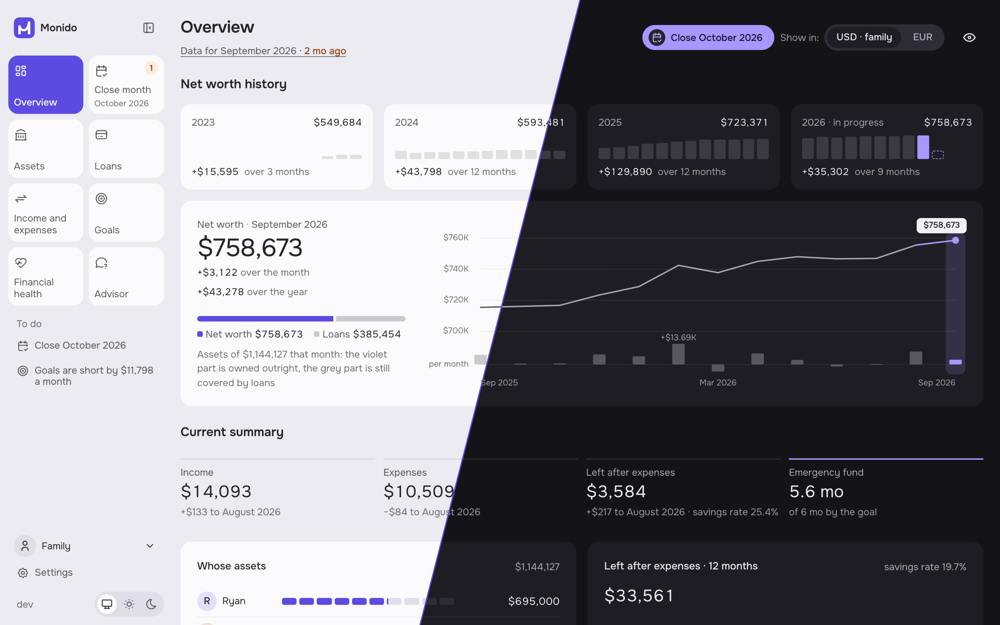

<p align="center"><a href="README.md">English</a> · <a href="README.ru-RU.md">Русский</a> · <a href="README.de-DE.md">Deutsch</a> · <a href="README.es-ES.md">Español</a> · <a href="README.fr-FR.md">Français</a> · <a href="README.pt-BR.md">Português</a> · <a href="README.zh-CN.md">中文</a></p>

<p align="center">
  
</p>

<h1 align="center">Monido</h1>

<p align="center">
  Учёт капитала и денежного потока, для себя или всей семьи. На своём сервере, данные вводятся вручную, без подключения к банкам.
</p>

<p align="center">
  <a href="https://github.com/stanislav-petryashov/monido/releases/latest"></a>
  <a href="https://github.com/stanislav-petryashov/monido/actions/workflows/docker.yml"></a>
  <a href="LICENSE"></a>
  <a href="https://github.com/stanislav-petryashov/monido/commits/master"></a>
  <a href="https://github.com/stanislav-petryashov/monido/pkgs/container/monido"></a>
  <a href="https://demo.monido.dev"></a>
  <a href="https://registry.modelcontextprotocol.io/v0.1/servers?search=io.github.stanislav-petryashov/monido"></a>
</p>

<p align="center">
  <a href="https://monido.dev">Сайт</a> · <a href="https://demo.monido.dev">Демо</a> · <a href="#быстрый-старт">Быстрый старт</a> · <a href="#документация">Документация</a> · <a href="#как-помочь-проекту">Помочь проекту</a> · <a href="https://github.com/stanislav-petryashov/monido/releases">Релизы</a>
</p>

<p align="center">
  
</p>

## Зачем Monido?

Для тех, кто хочет понимать свои деньги месяц за месяцем, в одиночку или вместе с семьёй.

- **Данные под вашим контролем.** Monido работает на вашем сервере, база данных и резервные копии остаются у вас, а дополнительные интеграции вы включаете сами.
- **Финансы всей семьи в одном месте.** Счета, инвестиции, недвижимость и кредиты собраны вместе, суммы сгруппированы по владельцам и валютам.
- **Видно движение без подключения банка.** Вводите остатки раз в месяц и, по желанию, доходы и расходы, и вы увидите, как меняются капитал и цели. Записывать каждую покупку не нужно.

## Возможности

- **Капитал и денежный поток:** история по месяцам, структура активов, категории доходов и расходов, норма сбережений. Можно вести только остатки, а можно и доходы с расходами.
- **Ежемесячное обновление:** мастер «Закрыть месяц» с автосохранением; в расчёты дашборда попадают только закрытые месяцы.
- **Кредиты и недвижимость:** оценки недвижимости, графики платежей и сравнение вариантов досрочного погашения.
- **Цели и финансовая независимость:** прогресс, прогнозы, альтернативные сценарии и пояснения к расчётам.
- **Финансовое здоровье:** показатели, их пороги и цифры, из которых они получены; неполные данные не скрываются.
- **Интеграции с Claude и Telegram (по желанию):** ввод данных по банковским выпискам, вопросы о финансах, предложения семье и напоминания. Советнику нужны HTTPS и вход по семейному паролю или через Telegram; для основного дашборда эти сервисы не нужны.
- **Сделано для своего сервера:** один Docker-контейнер и база SQLite, резервные копии и восстановление, история изменений с отменой поддерживаемых операций, несколько валют, светлая и тёмная темы.

## Примеры

Посмотрите [семь сценариев из семейных финансов](docs/use-cases/README.md): капитал в нескольких валютах, капитал за вычетом долгов, сбережения за месяц, подушка безопасности, накопление на цель, семейные решения с Советником и закрытие месяца по банковским выпискам через Claude. В каждом примере есть вымышленные данные, результаты проверки и ограничения.

## Быстрый старт

Хотите сначала посмотреть? [Откройте демо](https://demo.monido.dev): вымышленная семья, личная копия на 15 минут, ничего не нужно устанавливать. Пароль от демо показан на экране входа. Изменения затрагивают только вашу временную копию.

В демо нет Советника на Claude и напоминаний в Telegram, а скачивание базы данных отключено. Всё это доступно в вашей собственной установке. Пожалуйста, вводите в демо только вымышленные данные.

Нужен Docker с Docker Compose версии 2.24 или новее (Linux или Docker Desktop на macOS). В новой папке выполните:

```bash
mkdir monido && cd monido
curl -fsSLO https://raw.githubusercontent.com/stanislav-petryashov/monido/master/docker-compose.yml
docker compose up -d
```

В течение 15 минут откройте http://127.0.0.1:8080 и задайте семейный пароль. Вход по паролю или через Telegram настраивается в веб-интерфейсе; настройки сервера (порт, адрес) задаются в необязательном файле `.env` ([`.env.example`](.env.example), [полное руководство](docs/deploy-docker.md#installation)). Обновление: `docker compose pull && docker compose up -d`. Что-то не работает? [Решение проблем](docs/deploy-docker.md#troubleshooting).

Данные хранятся в Docker-томе, названном по имени папки (`monido_data`). Команда `docker compose down -v` удалит его, поэтому никогда не добавляйте `-v`.

## Где взять

- **Docker Compose** на любом Linux-сервере или в Docker Desktop: см. [Быстрый старт](#быстрый-старт). Образ: `ghcr.io/stanislav-petryashov/monido` (amd64 и arm64).
- **Unraid:** найдите Monido в Community Applications. Приложение работает от имени владельца папки с данными (по умолчанию `PUID` 99, `PGID` 100).
- **PikaPods** (управляемый хостинг): пока недоступно. [Проголосуйте за Monido](https://feedback.pikapods.com/posts/1289/monido-self-hosted-family-net-worth-and-cash-flow-tracker), чтобы его добавили.
- **Коннектор для Claude (MCP):** есть в [официальном реестре MCP](https://registry.modelcontextprotocol.io/v0.1/servers?search=io.github.stanislav-petryashov/monido) и на [Glama](https://glama.ai/mcp/servers/stanislav-petryashov/monido).

## Языки

Интерфейс доступен на английском, русском, немецком, испанском, французском, бразильском португальском и упрощённом китайском. Тексты на немецком, испанском, французском, португальском и китайском переведены машинно и ждут проверки носителями языка. Исправления приветствуются: см. [Translating](docs/translating.md).

[](https://hosted.weblate.org/engage/monido/)

Переводы ведутся в [Weblate](https://hosted.weblate.org/engage/monido/): выберите свой язык, исправьте или одобрите строки, и изменения придут в этот репозиторий пулл-реквестом.

Этот README переведён с английского; если они расходятся, верна [английская версия](README.md).

## Документация

Документация написана на английском языке.

- [Руководство пользователя](docs/user-guide.md): страницы, ежемесячное обновление и настройки.
- [Конфигурация](docs/configuration.md): переменные окружения, режимы входа и дополнительные интеграции.
- [Развёртывание](docs/deploy-docker.md): Docker, HTTPS за обратным прокси, обновления и резервные копии, публичное демо.
- [Разработка](docs/development.md): запуск из исходников, команды и скриншоты.
- [Архитектура](docs/architecture.md): карта кода, модель данных и инструкции.
- [Финансовые правила](docs/finance-rules.md): как считается и оценивается каждый показатель.
- [Схема базы данных](docs/schema.md): текущие таблицы и правила совместимости.
- [Дизайн-система](docs/design-system.md): токены, компоненты и правила интерфейса.
- [Сопровождение](docs/maintaining.md): первый публичный релиз и выпуск новых релизов.

## Как помочь проекту

Помочь можно кодом, более понятной документацией, исправлением переводов, улучшением доступности, проверкой расчётов или отчётами о работе на реальной домашней установке.

Начните с [CONTRIBUTING.md](CONTRIBUTING.md): там описаны настройка окружения и правила для участников. [Создайте issue](https://github.com/stanislav-petryashov/monido/issues/new/choose), чтобы сообщить о проблеме или обсудить идею перед крупным изменением. Хотите со временем взять на себя какую-то часть проекта? Напишите, чем вы пользуетесь и над чем хотели бы работать.

Если Monido вам полезен, звезда на GitHub или рекомендация тому, кому он нужен, помогают проекту.

## Безопасность

Вход, сессии, ограничение частоты запросов, Content-Security-Policy и как сообщить об уязвимости конфиденциально: [SECURITY.md](SECURITY.md).

## Лицензия

[MIT](LICENSE).
