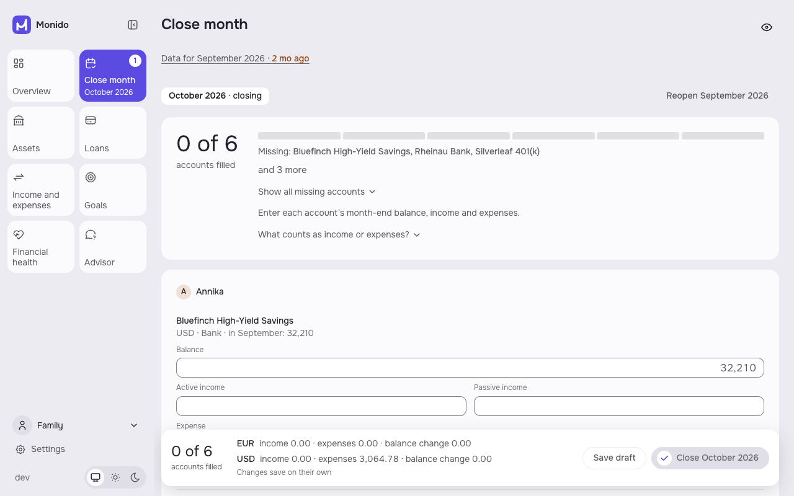
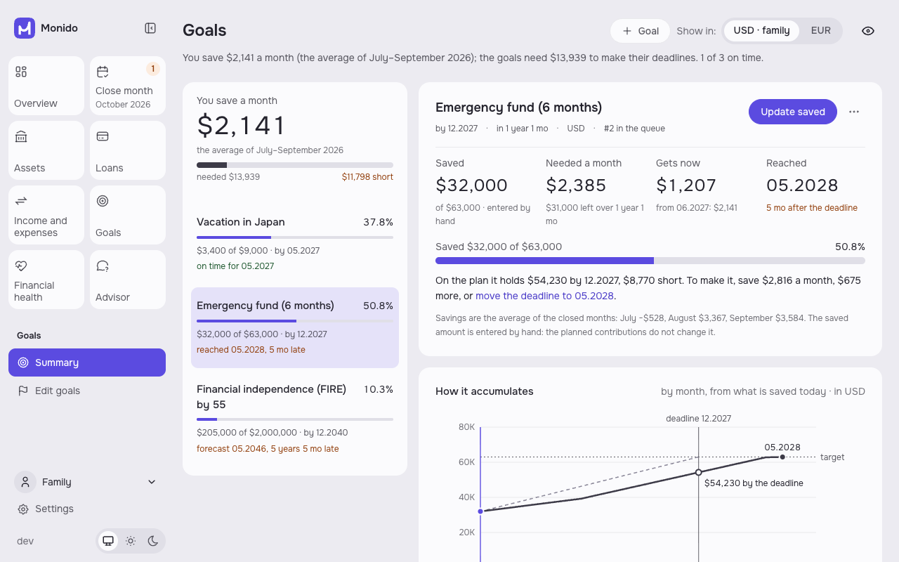
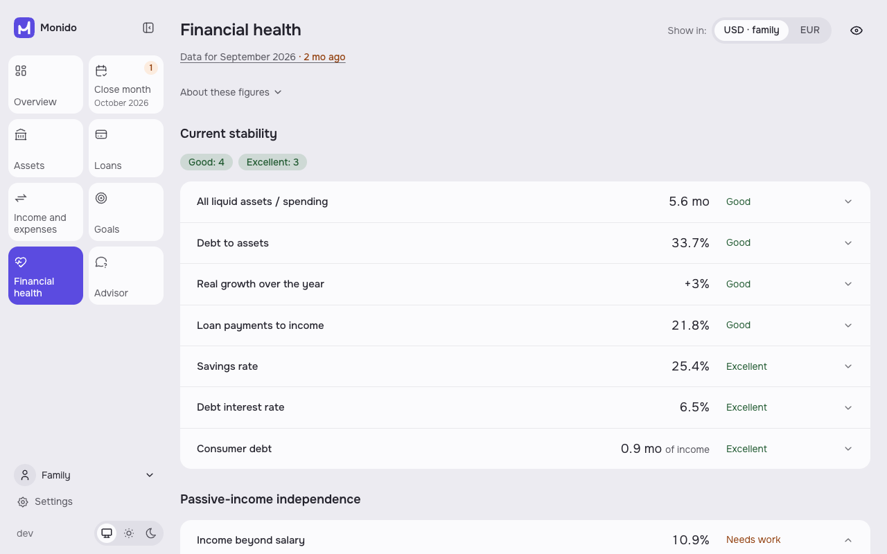
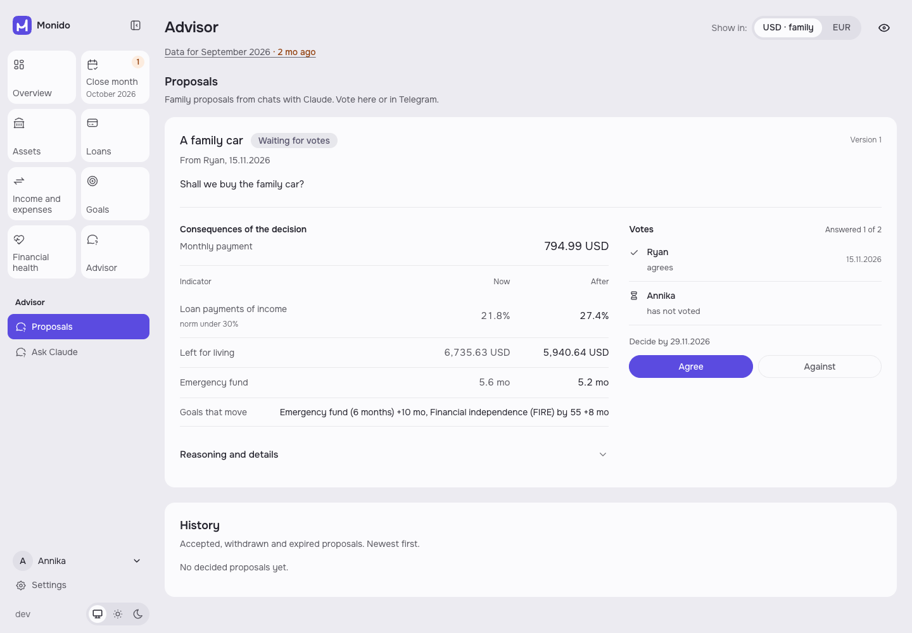
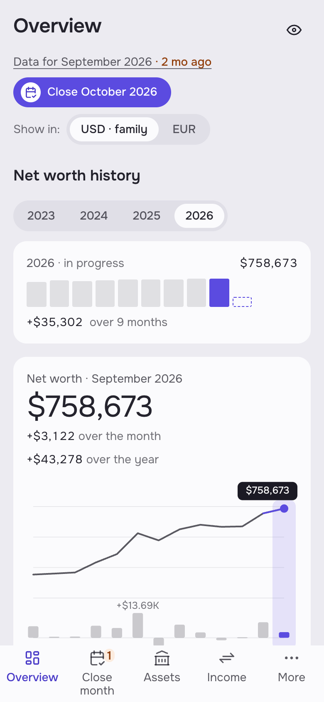

<p align="center"><a href="README.md">English</a> · <a href="README.ru-RU.md">Русский</a> · <a href="README.de-DE.md">Deutsch</a> · <a href="README.es-ES.md">Español</a> · <a href="README.fr-FR.md">Français</a> · <a href="README.pt-BR.md">Português</a> · <a href="README.zh-CN.md">中文</a></p>

<p align="center">
  
</p>

<h1 align="center">Monido</h1>

<p align="center">
  Track your net worth and cash flow, on your own or as a family. Self-hosted, entered by hand, no bank connections.
</p>

<p align="center">
  <a href="https://github.com/stanislav-petryashov/monido/releases/latest"></a>
  <a href="https://github.com/stanislav-petryashov/monido/actions/workflows/docker.yml"></a>
  <a href="LICENSE"></a>
  <a href="https://github.com/stanislav-petryashov/monido/commits/master"></a>
  <a href="https://github.com/stanislav-petryashov/monido/pkgs/container/monido"></a>
  <a href="https://demo.monido.dev"></a>
  <a href="https://registry.modelcontextprotocol.io/v0.1/servers?search=io.github.stanislav-petryashov/monido"></a>
</p>

<p align="center">
  <a href="https://monido.dev">Website</a> · <a href="https://demo.monido.dev">Live demo</a> · <a href="#quick-start">Quick start</a> · <a href="#documentation">Docs</a> · <a href="#contributing">Help build Monido</a> · <a href="https://github.com/stanislav-petryashov/monido/releases">Releases</a>
</p>

<p align="center">
  <a href="https://demo.monido.dev">Try the live demo</a>: a fictional family in a private copy for 15 minutes, nothing to install; the sign-in screen shows the password.
</p>

<p align="center">
  
</p>

## 为什么选择 Monido？

- **数据由你掌控。** 在你自己的服务器上运行，数据库和备份都在你手里，可选的集成由你决定是否开启。
- **看到全家的财务。** 把账户、投资、房产和贷款放在一个视图里，金额按持有人和货币分组。
- **不连接银行也能看清进展。** 每月录入余额，也可以录入收入和支出，就能看到净资产和目标的变化。不需要每天记账。
- **How long would we last without income?** The emergency fund in months of spending. [Example](docs/use-cases/emergency-reserve.md) · [formula](docs/finance-rules.md#rule-1-emergency-fund-emergency_months)
- **When do we reach our goals, and can we afford this?** Goal dates from what you actually save; with the optional Claude advisor, a purchase or a loan weighed against your own numbers and sent to the family for a vote. [Goals](docs/use-cases/savings-goal.md) · [A family decision](docs/use-cases/family-decision.md)

## 功能

You need Docker with Docker Compose v2.24 or newer (Linux, or Docker Desktop on macOS). In a new folder:

```bash
mkdir monido && cd monido
curl -fsSLO https://raw.githubusercontent.com/stanislav-petryashov/monido/master/docker-compose.yml
docker compose up -d
```

Open http://127.0.0.1:8080 within 15 minutes and set the family password. Server settings (port, address) go in an optional `.env` ([`.env.example`](.env.example), [the full guide](docs/deploy-docker.md#installation)). To update: `docker compose pull && docker compose up -d`. Something not working? [Troubleshooting](docs/deploy-docker.md#troubleshooting).

**What it needs:** one container (Node and SQLite, no separate database server) for amd64 and arm64, so a Raspberry Pi or a NAS will do; under 60 MB of memory when idle (`docker stats` on the demo and a home installation, versions 1.2 to 1.4) and a 250 MB image.

The data is kept in a Docker volume named after the folder (`monido_data`); `docker compose down -v` would delete it, so never add `-v`. The demo has no Claude advisor or Telegram reminders and cannot download its database; your own installation has them.

## 实际示例

<table>
  <tr>
    <td width="50%"><br><sub><b>Close month</b>: once a month, saved as you type</sub></td>
    <td width="50%"><br><sub><b>Goals</b>: dates from what you actually save, and what would move them</sub></td>
  </tr>
  <tr>
    <td width="50%"><br><sub><b>Financial health</b>: each figure with its threshold and its formula</sub></td>
    <td width="50%"><br><sub><b>Advisor</b> (optional): a decision with its consequences, voted on by the family</sub></td>
  </tr>
</table>

<p align="center"></p>

## 快速开始

想先看看？[试用演示](docs/finance-rules.md)：一个虚构的家庭，一份 15 分钟的私有副本，无需安装。登录页面上会显示演示密码。你的修改只影响你的临时副本。

演示不包含 Claude 顾问和 Telegram 提醒，也不能下载数据库。这些功能在你自己的安装中可用。请在演示中只使用虚构数据。

你需要 Docker 和 Docker Compose v2.24 或更新版本（Linux，或 macOS 上的 Docker Desktop）。在一个新文件夹中执行：

## 获取方式

- **Docker Compose**，适用于任何 Linux 服务器或 Docker Desktop：见[快速开始]{1}。镜像是 `ghcr.io/stanislav-petryashov/monido`（amd64 和 arm64）。
- **Unraid：** 在 Community Applications 中搜索 Monido。它以数据文件夹所有者的身份运行（默认 `PUID` 99，`PGID` 100）。
- **PikaPods**（托管服务）：暂不可用。[为 Monido 投票]{1}，让它被加入。
- **Claude 连接器（MCP）：** 已收录在[官方 MCP Registry]{1} 和 [Glama]{2}。
- **For the family:** shared records, sign-in with a family password or per person through Telegram, rights per member, reminders and proposals in Telegram.
- **Self-hosting:** backups and restore, all data exportable to CSV, change history with undo, multiple currencies, seven languages, light and dark themes.

## 语言

界面支持英语、俄语、德语、西班牙语、法语、巴西葡萄牙语和简体中文。德语、西班牙语、法语、葡萄牙语和中文文本是机器翻译，正在等待母语者审校。欢迎指正：见 [Translating]{1}。

## 文档

以下文档均为英文。

## 参与贡献

- **Docker Compose** on any Linux server or Docker Desktop: see [Quick start](#quick-start). The image is `ghcr.io/stanislav-petryashov/monido` (amd64 and arm64).
- **Unraid:** search for Monido in Community Applications. It runs as the data folder's owner (`PUID` 99, `PGID` 100 by default).
- **PikaPods** (managed hosting): not yet available. [Vote for Monido](https://feedback.pikapods.com/posts/1289/monido-self-hosted-family-net-worth-and-cash-flow-tracker) to have it added.
- **Claude connector (MCP):** listed in the [official MCP Registry](https://registry.modelcontextprotocol.io/v0.1/servers?search=io.github.stanislav-petryashov/monido) and on [Glama](https://glama.ai/mcp/servers/stanislav-petryashov/monido).

## 安全

登录、会话、限流、Content-Security-Policy，以及如何私下报告漏洞：[SECURITY.md](docs/translating.md)。

[](https://hosted.weblate.org/engage/monido/)

Translations are managed on [Weblate](https://hosted.weblate.org/engage/monido/): pick your language, fix or approve strings, and the changes come back to this repository as a pull request.

## 许可证

- [Worked examples](docs/use-cases/README.md): seven household questions with fictional data, verification results and limits.
- [User guide](docs/user-guide.md): the pages, the monthly update and the settings.
- [Configuration](docs/configuration.md): environment variables, sign-in modes and optional integrations.
- [Deployment](docs/deploy-docker.md): Docker, HTTPS behind a reverse proxy, updates and backups, the public demo.
- [Development](docs/development.md): running from source, the commands and the screenshots.
- [Architecture](docs/architecture.md): the code map, the data model and how-tos.
- [Finance rules](docs/finance-rules.md): how each metric is calculated and judged.
- [Database schema](docs/schema.md): the current tables and compatibility rules.
- [Design system](docs/design-system.md): tokens, components and rules for the interface.
- [Maintaining](docs/maintaining.md): the first public release and cutting a release.

## Contributing

Contributions can be code, clearer documentation, translation fixes, accessibility improvements, calculation checks or reports from a real self-hosted installation.

Start with [CONTRIBUTING.md](CONTRIBUTING.md) for setup and contribution guidelines. [Open an issue](https://github.com/stanislav-petryashov/monido/issues/new/choose) to report a problem; ask questions and discuss ideas, before a larger change too, in [Discussions](https://github.com/stanislav-petryashov/monido/discussions). Issues labelled [good first issue](https://github.com/stanislav-petryashov/monido/labels/good%20first%20issue) are a small, self-contained way in. Interested in helping maintain an area over time? Tell us which part you use and would like to work on.

If Monido is useful to you, a star or a mention to someone who needs it helps the project.

## Security

Login, sessions, throttling, the Content-Security-Policy and how to report a vulnerability privately: [SECURITY.md](SECURITY.md).

## License

[MIT](LICENSE).
