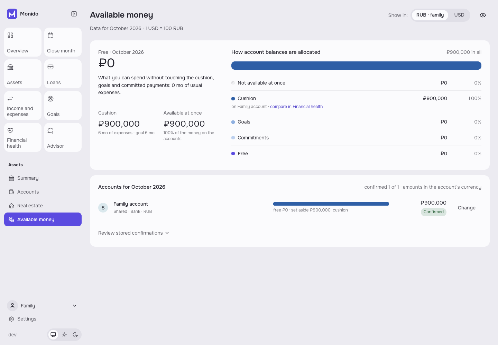

# How long would our available reserve last without income?

**RUB 900,000 deliberately reserved against RUB 150,000 of usual monthly spending covers six months. The apartment is not part of that reserve.**

## The situation

The family owns an apartment worth RUB 5 million and holds RUB 900,000 in its shared bank account. It wants to understand its cushion without assuming it could immediately sell its home.

August through October each contain RUB 150,000 of spending. The account is initially unconfirmed: the app must not silently decide that all of it is free to spend.

## Follow the case

1. Open Assets → Available money. Before confirmation, the free amount is unknown.
2. Confirm the shared account as available at once.
3. Set Cushion to RUB 900,000, with zero earmarked for other goals or commitments.
4. Save the monthly confirmation and reload the page.

Expected: six months of reserve coverage, RUB 900,000 available at once and **zero free to spend without touching the cushion**. Trying to reserve RUB 900,001 must be rejected.

## Verification

The runner creates an empty installation and three months of history, then fills and submits the reserve form in Chrome. It verifies persistence through HTTP, captures the six-month result, and checks the API refuses an over-allocation. The full results are in [the run report](results.md).

## Interpretation and follow-up

Confirmed reserve coverage uses three consecutive complete closed months ending at the balance month. The separate financial-health indicator uses all bank-class balances and the last closed month's expenses; those indicators happen to agree in this fixture, but need not agree in another family.

Six months assumes spending continues at the modeled level, no new income and no change in purchasing power. It is not a personalized emergency-fund recommendation. Confirm availability again when balances or earmarks change next month.

A useful contribution is an example where bank balances exceed the designated reserve, making the distinction unmistakable. Try [the demo](https://demo.monido.dev) or run `node --import tsx docs/use-cases/verify.mjs UC-03` after building for the exact fixture.
