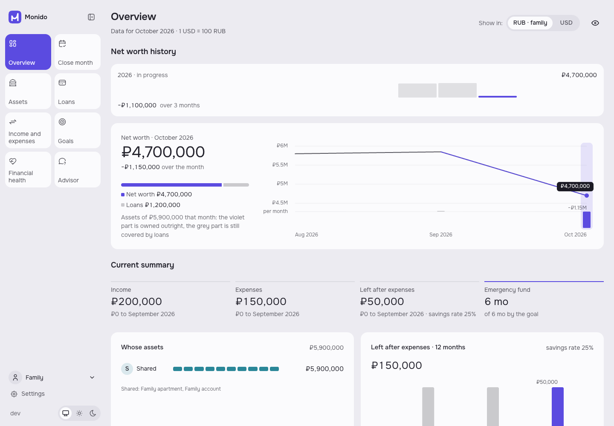

# How much does our family own after debts?

**A fictional household owns RUB 5.9 million in assets and owes RUB 1.2 million. Its net worth is RUB 4.7 million.** The apartment is part of wealth, not money available for tomorrow's bills.

## The situation

Alex and Maria keep a shared account and own an apartment. Looking at the account alone understates their wealth; looking at the apartment and account without their loan overstates it.

| October 2026 fixture | RUB |
| --- | ---: |
| Shared bank account | 900,000 |
| Apartment valuation | 5,000,000 |
| Assets | 5,900,000 |
| Outstanding loan | 1,200,000 |
| Net worth | 4,700,000 |

The intentionally simple zero-interest loan starts on October 1, with its first installment in November. It isolates subtraction of liabilities from interest calculations. Ownership is recorded once as Shared, not once per spouse.

## Follow the case

1. Open Overview after closing October. Read net worth and the date of the figures.
2. Open Assets to see the account and apartment separately.
3. Open Loans to inspect the obligation behind the deduction.
4. Reload the page: the same recorded month should produce the same result.

Expected: 5,900,000 - 1,200,000 = 4,700,000 RUB. No joint asset is counted twice. Repeat the review after the next month's balances and debt schedule change.

## Verification

The automated run initializes a new database, inserts the fictional history, starts the actual server, checks all three totals through HTTP and opens Overview, Assets and Loans in Chrome. It also checks the narrow viewport. See [recorded results](results.md).

## Limits and contribution opportunities

This example does not verify every loan schedule or manual entry workflow. It relies on the entered property valuation and the modeled loan balance. A property's selling costs are not automatically deducted by this example. Useful contributions include independently calculated cases with multiple owners and loans whose actual balance differs from the schedule.

To try the interface, use the [public demo](https://demo.monido.dev), which has a different fictional household. To reproduce these exact figures, run `node --import tsx docs/use-cases/verify.mjs UC-01` after building. No real household's satisfaction has been measured.
