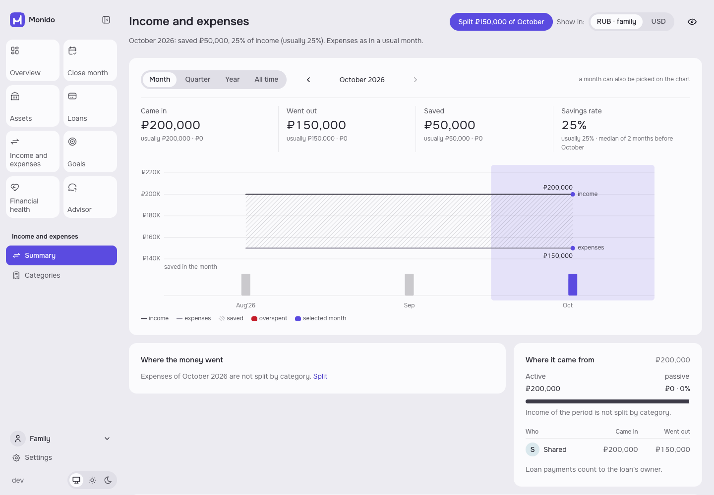

# How much can we regularly save after expenses and obligations?

**In this example the family has RUB 50,000 left each month, or 25% of income. This is a historical result, not a guarantee that the same amount will be available next month.**

## The situation

The family wants a starting point for savings instead of choosing an arbitrary contribution. August, September and October each contain RUB 200,000 of income and RUB 150,000 of expenses, with no loans in this fixture.

The independent expectation is `(200,000 - 150,000) / 200,000 = 25%`, with a three-month average surplus of RUB 50,000.

## Follow the case

1. Open Income and expenses and review the closed period.
2. Check income, expenses and the amount left over. Compare with Overview.
3. Use the three-month average as a planning assumption and separately consider upcoming bills or irregular income.
4. Revisit next month to see whether the amount is sustainable.

## Verification

A new installation is populated with exactly three closed months. HTTP assertions check income, expenses, the savings rate and average surplus. Chrome captures the actual pages. The test then turns income/expense tracking off through the settings API: unavailable figures must disappear rather than become zero. Re-enabling tracking must restore the original history.

See [recorded results](results.md). Settings changes in this case are API checks, not browser clicks.

## What this case does not establish

The displayed historical average does not automatically exclude a one-off bonus or reserve money for every future annual bill. There are no loan payments in this particular fixture. So the promise of a reliably affordable future saving amount is **partially verified**. The verified result is the historical surplus and its use as an explicit assumption.

A useful contribution is a scenario with seasonal income, annual insurance and actual debt payments, with a clearly justified expected planning amount. The calculation should explain its assumptions before presenting that amount as sustainable.

Try [the demo](https://demo.monido.dev) to explore the pages, or reproduce this fixture with `node --import tsx docs/use-cases/verify.mjs UC-02` after building.
