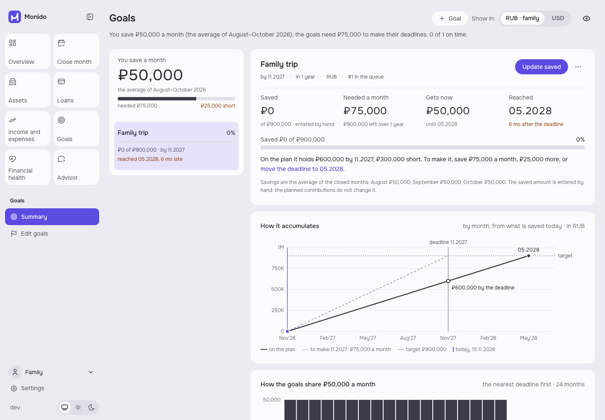

# When will we reach our savings goal, and what changes that date?

**A RUB 600,000 trip funded at RUB 50,000 per month is forecast for November 2027. Increasing its cost to RUB 900,000 moves the forecast to May 2028.** These dates refer to the November 2026 test run.

## The situation

A family has one goal, no money recorded as already saved for it, and a three-month average surplus of RUB 50,000. It plans a trip in twelve months. This deliberately avoids competing goals so the arithmetic is easy to check.

## Follow the case

1. Open Goals and select Family trip.
2. Check Amount to save, Already saved, the monthly allocation and the projected date.
3. Open Update saved, increase Amount to save from RUB 600,000 to RUB 900,000, and save.
4. Reload Goals and inspect the changed forecast and missed-deadline status.

Expected: 600,000 / 50,000 = twelve months initially; 900,000 / 50,000 = eighteen months after the change. The planned deadline stays November 2027, so the larger target is at risk.

## Verification

The runner starts a separate empty installation, inserts the historical budget and one goal, checks the original projection through HTTP, and changes the target using the actual browser form. It then reloads the page and verifies the persisted target's forecast and status. See [recorded results](results.md).

## Limits and contributions

This is a projection with constant historical saving capacity, no return for this ordinary goal and no competing goal. The app allocates to deadlines; it does not promise to finish every goal as early as mathematically possible. The Already saved amount is entered by hand: time passing and money earmarked in Available money do not automatically update it.

Return each month to update actual savings and review the new forecast. Useful follow-ups include two competing goals, a month with negative savings and a deadline that has already passed.

Explore [the demo](https://demo.monido.dev), or reproduce this case with `node --import tsx docs/use-cases/verify.mjs UC-05` after building.
