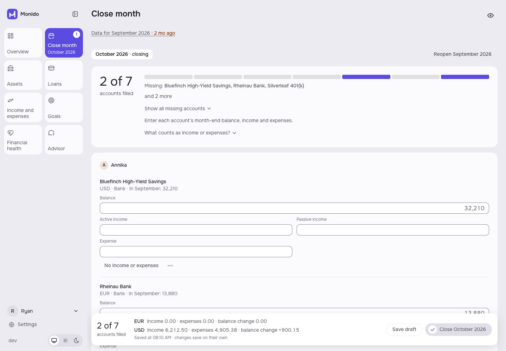
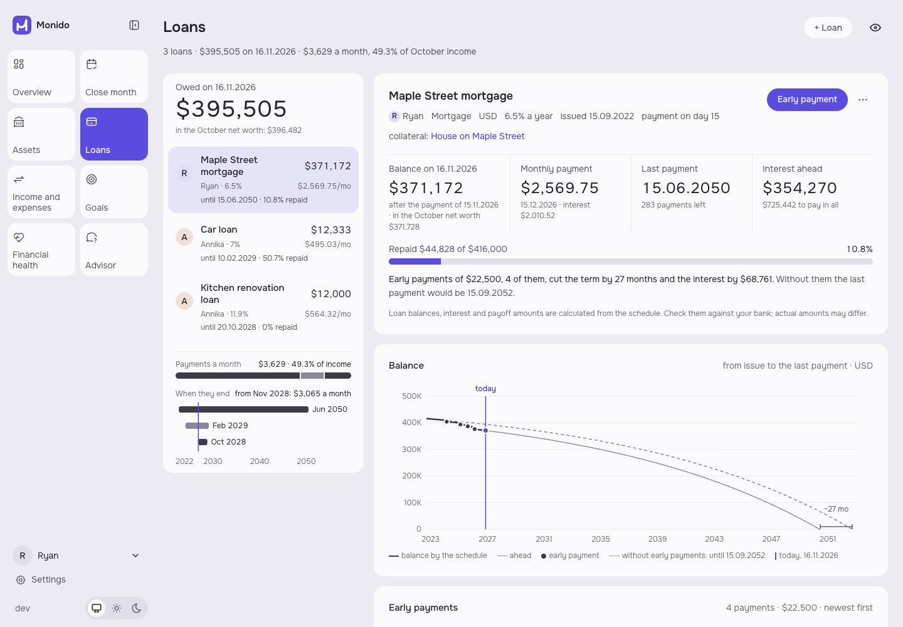

# How can we close the month from bank statements without typing them in?

**Send Claude a statement or a loan agreement; the app checks what Claude read and shows a draft. Nothing is written until you say yes, and the month closes only when you say so.** Claude reads the documents; the app never parses files, moves money or connects to a bank.

## The situation

The fictional demo family, Ryan and Annika, closes October 2026. Ryan's checking statement shows a closing balance of USD 8,420.15, a USD 6,200 salary, USD 1,840.60 of spending in two categories, and the scheduled mortgage and car loan payments. Annika opened a new savings account that month and signed a USD 12,000 kitchen renovation loan at 11.9% for 24 months. The other accounts had no movement.

## Follow the case

1. Claude reads the open month: which accounts and loan payments still miss figures.
2. It previews the checking statement: balance, income, spending by category and the loan payments. The preview writes nothing.
3. After the user's yes it files the statement into the month's draft. The same preview cannot be filed twice.
4. A misread account name ("Harborline Checkng") is not added as a second account: the app refuses it and names the look-alike, so Claude must ask whether it is new or the existing one.
5. Annika's new account is previewed as new and filed after the yes.
6. The loan agreement: a name like an existing loan ("Car loan 2") is refused the same way; the kitchen loan is previewed with its schedule, then saved once after the yes.
7. The accounts without movement are carried over only when the user says so, and the month closes only on an explicit "close".

The independent annuity check is `12,000 × (0.119 / 12) / (1 - (1 + 0.119 / 12)^-24)`, or USD 564.32 a month, the payment the preview shows.

## Verification and external boundaries

**Automated run.** A separate empty database is initialized with the established fictional family; the test signs in through the project's local Telegram stand and calls the advisor tools over HTTP. It checks every step above against values computed in the test, including that previews write nothing, that the look-alike account and loan are refused with the existing names, and that the month closes once. Consent is scripted for the fixture. Claude's reading of documents, OAuth and the "via Claude" label in Change history are not exercised: tool calls over HTTP are recorded as the member.

**Supervised live run (16 November 2026).** Claude on claude.ai, connected through the advisor's connector to a test installation holding the Russian demo family, was given four fictional PDF documents written for the run: a salary card statement, a savings account statement whose header spells the account differently from the app, a statement of a new deposit, and a consumer loan agreement. The expected figures were written down before the run. The conversation was operated in the maintainer's browser by an AI coding agent playing the user; every write was approved per tool call.

Observed in the server database after the run:

- Every figure matched the expectations to the cent: three balances, income and spending, 13 category lines, two loan payments, the new deposit, and the loan terms (RUB 450,000, 18.9%, 24 months, RUB 22,662.02 on the 20th).
- A RUB 50,000 transfer from the card to the new deposit was left out of income and spending on both sides.
- The savings statement was filed under the existing account despite the different spelling; no duplicate was created. Claude matched it itself, so the server's look-alike refusal was not needed in this run (the automated run covers it).
- Claude noticed on its own that the transfer did not arrive on the savings account and asked about a separate deposit; it flagged that the mortgage payment on the statement differed from the app's schedule (the fictional statement used the original payment, the schedule includes early repayments) and asked where the loan proceeds went.
- The four quiet accounts were carried over after the user said so; the month closed after "close"; every change is journaled with the advisor as its source.

This is one run with one model on clean, text-based documents. Scanned images, card statements with pending holds, multi-currency statements and contradictory documents were not tried. A correct run does not show that every statement will be read correctly: check the draft before you say yes.

To reproduce the automated protocol test, run `node --import tsx docs/use-cases/verify.mjs UC-08` after building. To use the feature, follow "Loading statements and loans through Claude" in the [user guide](../user-guide.md).
