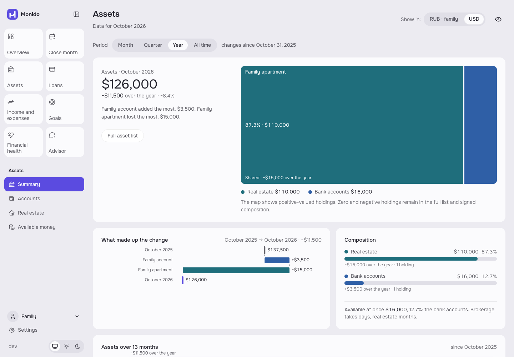

# Are we actually wealthier, or did prices and exchange rates change?

**The same household goes from RUB 11 million to RUB 12.6 million, but from USD 137,500 to USD 126,000. Both calculations are correct. They answer different questions.**

## The situation

The family's main asset is a ruble-valued apartment. Its price rises while the ruble weakens against the dollar. Meanwhile the family adds money to its bank account every month.

| Fictional input | October 2025 | October 2026 |
| --- | ---: | ---: |
| Apartment, RUB | 10,000,000 | 11,000,000 |
| Bank account, RUB | 1,000,000 | 1,600,000 |
| Total net worth, RUB | 11,000,000 | 12,600,000 |
| RUB per USD | 80 | 100 |
| Total net worth, USD | 137,500 | 126,000 |

The fixture has thirteen closed observations. Monthly income is RUB 200,000 and expenses RUB 150,000. There are twelve saving intervals: RUB 600,000 of contributions. Property valuation and the exchange rate change at the start of 2026. These are illustrative inputs, not historical market quotations.

## Follow the case

1. Open Assets and select Year. In RUB, the increase is RUB 1.6 million.
2. Switch the display currency to USD. The year now shows a decline of USD 11,500, approximately 8.4%.
3. Inspect the apartment: RUB 10m / 80 = USD 125,000 before, RUB 11m / 100 = USD 110,000 after. Its dollar value fell USD 15,000 despite its ruble price increasing.
4. Open Financial health. With the fixture's 10% ruble inflation, the app reports approximately +4.5% real growth using its documented method.

## What the checks prove

On a clean installation, HTTP assertions independently verify both currency totals, RUB 600,000 of contributions and RUB 1 million of growth beyond those contributions. Chrome exercises the Year and USD buttons. The inflation measure remains based on RUB when display currency changes. The separate short-history fixture checks that an annual growth-beyond-savings rate is withheld when history is insufficient.

The app's documented real-growth calculation is nominal growth minus inflation: `(12.6 / 11 - 1) × 100 - 10`, rounded to 4.55%. This is not the exact ratio-based inflation adjustment. Growth includes the family's contributions; it is not investment performance. Currency comparison alone also does not measure a household's purchasing power.

## The gap exposed by the case

**The broader story is partially verified.** The server calculates growth beyond savings, but its UI explanation is currently inside the financial-independence goal's Forecasts section. This fixture deliberately has no such goal. A family can compare valuations across currencies, but it does not get one direct explanation separating contributions, asset revaluation and currency effects on the main wealth page.

That is a concrete contribution opportunity: expose the already calculated evidence in the wealth workflow, explain its period and missing-data limits, and avoid describing it as pure market return. Do not add an unrelated financial-independence goal merely to make this case appear complete.

Revisit annually and after a valuation change. See [the verification report](results.md); explore [the demo](https://demo.monido.dev) or run `node --import tsx docs/use-cases/verify.mjs UC-04` after building for the reference fixture.
